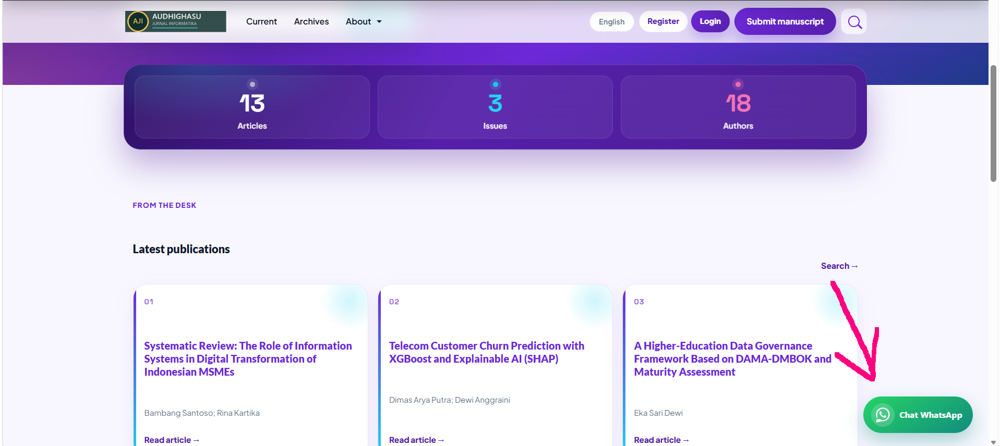

# WA-Float — WhatsApp Floating Button for OJS

[English](#english) · [Bahasa Indonesia](#bahasa-indonesia)

**Plugin name:** WA-Float  
**Author:** Edi Suherlan  
**Website:** [audhighasu.com](https://audhighasu.com)  
**Demo OJS:** [ojs.audhighasu.com](https://ojs.audhighasu.com/)  
**Email:** audhighasu@gmail.com  
**Compatible with:** Open Journal Systems (OJS) 3.5  
**License:** MIT  
**Repository:** [github.com/edisuherlan/PluginOJS-Whatsapp-Floating-Button](https://github.com/edisuherlan/PluginOJS-Whatsapp-Floating-Button)

### Live preview / Pratinjau langsung



> See the floating **Chat WhatsApp** button in action on a real journal site:  
> **[https://ojs.audhighasu.com/](https://ojs.audhighasu.com/)**  
>  
> Lihat tombol **Chat WhatsApp** mengambang langsung di situs jurnal demo:  
> **[https://ojs.audhighasu.com/](https://ojs.audhighasu.com/)**

Need OJS themes, custom journal design, or plugin support? Visit **[audhighasu.com](https://audhighasu.com)** or explore the demo at **[ojs.audhighasu.com](https://ojs.audhighasu.com/)**.

---

<a id="english"></a>

## English

### Overview

**WA-Float** is a free OJS generic plugin that shows a floating WhatsApp button on your journal’s public site. Visitors can click it to open WhatsApp with a pre-filled message to the journal manager.

Creator credit appears in the **plugin settings (backend)** only — not on the public website.

**Try it live:** [ojs.audhighasu.com](https://ojs.audhighasu.com/) — Audhighasu Jurnal Informatika (OJS demo by [audhighasu.com](https://audhighasu.com)).

### Screenshot


*WA-Float on the journal homepage (bottom-right). Demo: [ojs.audhighasu.com](https://ojs.audhighasu.com/).*

### Features

| Feature | Description |
|--------|-------------|
| Floating WhatsApp button | Fixed button on the public frontend |
| Manager phone number | Set the journal’s WhatsApp number |
| Pre-filled message | Auto-filled text when WhatsApp opens |
| Button label | Custom text next to the icon (optional) |
| Position presets | Bottom right, bottom left, top right, top left |
| Custom coordinates | Manual `top` / `right` / `bottom` / `left` |
| Edge offsets | Adjust distance from screen edges |
| Color styles | WhatsApp green, Emerald, Ocean, Sunset, Midnight, Orchid |
| Show / hide label | Icon-only or icon + text |
| Enable / disable | Toggle visibility on the public site |
| Responsive | Works on desktop and mobile |
| Backend credit | Author credit in settings only |

### Requirements

- OJS **3.5.x**
- PHP compatible with your OJS installation
- Write access to the OJS `plugins/generic/` folder (for install)
- Journal Manager / Site Admin access to enable the plugin

### Installation

#### Method A — Download from GitHub

1. Download this repository as ZIP from GitHub, or clone it:
   ```bash
   git clone https://github.com/edisuherlan/PluginOJS-Whatsapp-Floating-Button.git waFloat
   ```
2. Ensure the folder is named **`waFloat`** (case-sensitive on Linux).
3. Copy the folder into your OJS installation:
   ```text
   ojs/
   └── plugins/
       └── generic/
           └── waFloat/
               ├── index.php
               ├── WaFloatPlugin.php
               ├── WaFloatSettingsForm.php
               ├── version.xml
               ├── settings.xml
               ├── LICENSE
               ├── README.md
               ├── Screenshoot.PNG
               ├── locale/
               ├── styles/
               └── templates/
   ```
4. Clear the OJS cache:
   - Via admin: **Administration → Clear Data Caches / Clear Template Cache**, or
   - Delete files under `cache/` (and `cache/t_compile/` if present).
5. Log in as Journal Manager / Admin.
6. Go to **Settings → Website → Plugins**.
7. Find **WA-Float** under Generic Plugins and click **Enable**.
8. Open **Settings** on the plugin and configure your WhatsApp number.

#### Method B — Manual upload (shared hosting)

1. Download the ZIP from this repository.
2. Extract it and rename the root folder to `waFloat` if needed.
3. Upload `waFloat` to `plugins/generic/` via FTP / File Manager.
4. Clear cache, then enable the plugin as in steps 5–8 above.

### Configuration

Open **WA-Float → Settings** and configure:

| Setting | Description | Example |
|--------|-------------|---------|
| Show on public site | Enable/disable the float button | Checked |
| Show text label | Show “Chat WhatsApp” (or custom) beside the icon | Checked |
| Manager WhatsApp number | International format without `+`. Leading `0` becomes `62` | `6281234567890` |
| Pre-filled message | Text sent when the visitor opens WhatsApp | `Hello, I would like to ask about this journal.` |
| Button label | Visible label text | `Chat WhatsApp` |
| Float position | Corner preset or custom coordinates | `Bottom right` |
| Horizontal / vertical offset | Distance from the edge (for presets) | `24` or `1.5rem` |
| Custom top/right/bottom/left | Used when position = Custom | `right: 24`, `bottom: 24` |
| Color style | Visual preset | WhatsApp green |

After saving, hard-refresh the public journal page (`Ctrl+F5`) to see changes.

### Color styles

- **whatsapp** — classic WhatsApp green  
- **emerald** — modern green  
- **ocean** — blue  
- **sunset** — orange  
- **midnight** — dark slate  
- **orchid** — purple  

### Position tips

- Use **Bottom right** for the most common chat-widget layout.
- Use **Custom** if you need exact placement (e.g. avoid overlapping another widget).
- Offsets accept bare numbers (`24` → `24px`) or units (`2rem`, `3vw`, `5%`).

### Uninstall

1. Disable **WA-Float** in **Settings → Website → Plugins**.
2. Delete the folder `plugins/generic/waFloat/`.
3. Clear OJS cache.

### Troubleshooting

| Problem | What to try |
|--------|-------------|
| Plugin not listed | Folder must be `plugins/generic/waFloat`; clear cache; check file permissions |
| Button not visible | Confirm plugin is enabled; “Show on public site” is checked; phone number is filled |
| Wrong WhatsApp contact | Use country code without `+` (e.g. `62…` for Indonesia) |
| Style not updating | Hard refresh (`Ctrl+F5`) or clear browser + OJS cache |
| Opens blank chat | Check that the number is valid and the message field is not broken by special encoding |

### Demo, themes & support

- **Live demo (this plugin running on OJS):** [https://ojs.audhighasu.com/](https://ojs.audhighasu.com/)
- **Themes, custom OJS work & services:** [https://audhighasu.com](https://audhighasu.com)
- **Contact:** audhighasu@gmail.com · **Author:** Edi Suherlan

Looking for ready-made OJS themes (Scholar Modern, Nexus Academic, Aurora Kinetic, Insomniac, Medical Health, and more) or a custom journal look? Check the theme demo bar on [ojs.audhighasu.com](https://ojs.audhighasu.com/) and order via [audhighasu.com](https://audhighasu.com).

If this free plugin helps your journal, a star on GitHub is appreciated.

---

<a id="bahasa-indonesia"></a>

## Bahasa Indonesia

### Ringkasan

**WA-Float** adalah plugin generic OJS gratis yang menampilkan tombol WhatsApp mengambang (floating) di situs publik jurnal. Pengunjung bisa mengeklik tombol tersebut untuk membuka WhatsApp dengan pesan otomatis ke pengelola jurnal.

Kredit pembuat hanya tampil di **pengaturan plugin (backend)** — tidak ditampilkan di situs publik.

**Coba langsung:** [ojs.audhighasu.com](https://ojs.audhighasu.com/) — Audhighasu Jurnal Informatika (demo OJS oleh [audhighasu.com](https://audhighasu.com)).

### Screenshot


*WA-Float di beranda jurnal (pojok kanan bawah). Demo: [ojs.audhighasu.com](https://ojs.audhighasu.com/).*

### Fitur

| Fitur | Keterangan |
|--------|-------------|
| Tombol WhatsApp float | Tombol tetap di frontend publik |
| Nomor WA pengelola | Atur nomor WhatsApp jurnal |
| Pesan otomatis | Teks terisi saat WhatsApp terbuka |
| Label tombol | Teks kustom di samping ikon (opsional) |
| Posisi preset | Kanan bawah, kiri bawah, kanan atas, kiri atas |
| Koordinat manual | Atur `top` / `right` / `bottom` / `left` |
| Offset tepi | Atur jarak dari tepi layar |
| Gaya warna | Hijau WhatsApp, Emerald, Ocean, Sunset, Midnight, Orchid |
| Tampilkan / sembunyikan label | Hanya ikon atau ikon + teks |
| Aktif / nonaktif | Kontrol tampilan di situs publik |
| Responsif | Cocok untuk desktop dan mobile |
| Kredit di backend | Nama pembuat hanya di pengaturan |

### Persyaratan

- OJS **3.5.x**
- PHP sesuai instalasi OJS Anda
- Akses menulis ke folder `plugins/generic/` (untuk instalasi)
- Akses Journal Manager / Site Admin untuk mengaktifkan plugin

### Cara instalasi

#### Metode A — Unduh dari GitHub

1. Unduh repositori ini sebagai ZIP dari GitHub, atau clone:
   ```bash
   git clone https://github.com/edisuherlan/PluginOJS-Whatsapp-Floating-Button.git waFloat
   ```
2. Pastikan nama foldernya **`waFloat`** (sensitif huruf besar/kecil di Linux).
3. Salin folder ke instalasi OJS Anda:
   ```text
   ojs/
   └── plugins/
       └── generic/
           └── waFloat/
               ├── index.php
               ├── WaFloatPlugin.php
               ├── WaFloatSettingsForm.php
               ├── version.xml
               ├── settings.xml
               ├── LICENSE
               ├── README.md
               ├── Screenshoot.PNG
               ├── locale/
               ├── styles/
               └── templates/
   ```
4. Bersihkan cache OJS:
   - Lewat admin: **Administration → Clear Data Caches / Clear Template Cache**, atau
   - Hapus file di dalam `cache/` (dan `cache/t_compile/` jika ada).
5. Login sebagai Journal Manager / Admin.
6. Buka **Settings → Website → Plugins**.
7. Temukan **WA-Float** di Generic Plugins lalu klik **Enable**.
8. Buka **Settings** plugin dan isi nomor WhatsApp pengelola.

#### Metode B — Upload manual (shared hosting)

1. Unduh ZIP dari repositori ini.
2. Ekstrak, lalu rename folder root menjadi `waFloat` jika perlu.
3. Upload folder `waFloat` ke `plugins/generic/` via FTP / File Manager.
4. Clear cache, lalu aktifkan plugin seperti langkah 5–8 di atas.

### Konfigurasi

Buka **WA-Float → Settings** lalu atur:

| Pengaturan | Keterangan | Contoh |
|--------|-------------|---------|
| Tampilkan di situs publik | Aktif/nonaktif tombol float | Dicentang |
| Tampilkan label teks | Tampilkan “Chat WhatsApp” (atau kustom) di samping ikon | Dicentang |
| Nomor WhatsApp pengelola | Format internasional tanpa `+`. Angka `0` di depan diubah ke `62` | `6281234567890` |
| Pesan otomatis | Teks saat pengunjung membuka WhatsApp | `Halo, saya ingin bertanya tentang jurnal ini.` |
| Label tombol | Teks yang terlihat | `Chat WhatsApp` |
| Posisi float | Preset pojok atau koordinat manual | `Pojok kanan bawah` |
| Offset horizontal / vertikal | Jarak dari tepi (untuk preset) | `24` atau `1.5rem` |
| Custom top/right/bottom/left | Dipakai jika posisi = Custom | `right: 24`, `bottom: 24` |
| Gaya warna | Preset visual | Hijau WhatsApp |

Setelah disimpan, hard-refresh halaman publik jurnal (`Ctrl+F5`) untuk melihat perubahan.

### Gaya warna

- **whatsapp** — hijau klasik WhatsApp  
- **emerald** — hijau modern  
- **ocean** — biru  
- **sunset** — oranye  
- **midnight** — gelap  
- **orchid** — ungu  

### Tips posisi

- Gunakan **Pojok kanan bawah** untuk layout chat widget yang paling umum.
- Gunakan **Custom** jika butuh penempatan tepat (misalnya menghindari widget lain).
- Offset menerima angka saja (`24` → `24px`) atau dengan satuan (`2rem`, `3vw`, `5%`).

### Cara uninstall

1. Nonaktifkan **WA-Float** di **Settings → Website → Plugins**.
2. Hapus folder `plugins/generic/waFloat/`.
3. Clear cache OJS.

### Troubleshooting

| Masalah | Yang bisa dicoba |
|--------|-------------|
| Plugin tidak muncul | Folder harus `plugins/generic/waFloat`; clear cache; cek permission file |
| Tombol tidak tampil | Pastikan plugin aktif; opsi tampilkan di situs publik dicentang; nomor WA terisi |
| Kontak WA salah | Pakai kode negara tanpa `+` (mis. `62…` untuk Indonesia) |
| Tampilan tidak berubah | Hard refresh (`Ctrl+F5`) atau clear cache browser + OJS |
| Chat kosong / error | Pastikan nomor valid dan pesan tidak bermasalah |

### Demo, theme & dukungan

- **Demo langsung (plugin ini berjalan di OJS):** [https://ojs.audhighasu.com/](https://ojs.audhighasu.com/)
- **Theme, jasa kustom OJS & layanan:** [https://audhighasu.com](https://audhighasu.com)
- **Kontak:** audhighasu@gmail.com · **Pembuat:** Edi Suherlan

Butuh theme OJS siap pakai (Scholar Modern, Nexus Academic, Aurora Kinetic, Insomniac, Medical Health, dan lainnya) atau tampilan jurnal custom? Coba theme demo bar di [ojs.audhighasu.com](https://ojs.audhighasu.com/) dan order lewat [audhighasu.com](https://audhighasu.com).

Jika plugin gratis ini membantu jurnal Anda, silakan beri bintang di GitHub.

---

## License / Lisensi

MIT License — see [`LICENSE`](LICENSE).

Copyright (c) 2026 Edi Suherlan ([audhighasu.com](https://audhighasu.com))
